  
  

 

 

[

## Tech Stack 💻
### AI/ML

### Engineering and Deployment

### Data Science

### Edge Computing

### Tools

## Featured Projects 🌟
### Real-Time Transaction Fraud Detection API
**End-to-end MLOps pipeline for detecting fraudulent transactions, served via a production-ready REST API.**

**Key Features**
- Trained an XGBoost classifier model on 911K+ IEEE-CIS transaction records enriched with comprehensive feature engineering, effectively achieving an AUC-ROC of 0.9675 on test data
- Applied threshold tuning to optimise the precision-recall trade-off and achieved an F1 score of 0.7491 (+25% uplift from the baseline model), as well as SHAP explainability to outline interpretable fraud signals
- Packaging the trained model into a FastAPI inference service with Docker, targeting deployment on Google Cloud Run with a GitHub Actions CI/CD pipeline

**Repo:** [Real-Time Transaction Fraud Detection API](https://github.com/jonathanskuy/fraud-detection-api)

### Exploring the Relationship between Education Quality and Property Prices in Manchester
**Quantitative analysis of the relationship between school quality scores and property prices across Manchester.**

**Key Features**
- Integrated 1M+ UK property transaction data records with Ofsted school inspection scores and Index of Multiple Deprivation datasets to analyse their relationship using multiple linear regression 
- Discovered that education quality’s relationship with property prices is statistically significant (p < 0.01) while school access’ relationship holds less significance (p ≈ 0.352)
- Investigated possible links with socioeconomic deprivation and access to amenities, observing that they also reflect property price variation significantly (p < 0.01)
- Produced 10+ spatial visualisations and regression diagnostics to visualise variations and support results and investment insights

**Repo:** [Exploring the Relationship between Education Quality and Property Prices in Manchester](https://github.com/jonathanskuy/manchester-property-vs-education)

### London Property Price Prediction
**End-to-end machine learning pipeline for predicting property prices across London, built as a collaborative group project.**

**Key Features**
- Engineered a production-ready data pipeline processing 100,000+ London property transaction records, enriching each with geospatial coordinates via the ONS Postcode Directory dataset and filtering to 2024 transactions for recency and relevance
- Trained and tuned a CatBoost regression model across 1,000 iterations, improving R² from 0.840 to 0.844 and reducing MAE from 0.175 to 0.172 over the baseline, delivering robust price predictions across diverse property characteristics and external variables
- Deployed an interactive Gradio web application into a HuggingFace Space, enabling users to generate real-time property price estimates from customisable inputs
- Collaborated in a team of 6 with structured roles spanning data preprocessing, modelling, and evaluation; personally led feature engineering and model implementation while contributing significantly to the data preprocessing pipeline

**Repo:** [London Property Price Prediction](https://github.com/jonathanskuy/london-property-price-prediction)

**Interactive Application:** [London Property Price Predictor](https://huggingface.co/spaces/jonathanskuy/london-property-price-predictor)

### Cat Adoption Profile Optimiser
**AI-powered system focused on scoring cat adoption listings and giving recommendations to improve it, developed for the #HackTheKitty 2026 hackathon**

**Key Features**
- Developed and deployed a tested application to score cat adoption profiles using a binarised XGBoost model (ROC-AUC 
= ~0.68) and provide recommendations to users via the Google Gemini 2.5 Flash API, as part of a 2-person team
- Placed within the Top 25% out of 120+ submissions

**Repo:** [Cat Adoption Profile Optimiser](https://github.com/jonathanskuy/cat-profile-optimiser)

**Interactive Application:** [Cat Adoption Profile Optimiser](https://cat-profile-optimiser.streamlit.app/)

## Connect with Me
- **Email:** jonathanindarto1001@gmail.com
- **LinkedIn:** [Jonathan Indarto](https://linkedin.com/in/m-jonathan-indarto)

**Languages:** EN🇬🇧/ID🇮🇩/NL🇳🇱

